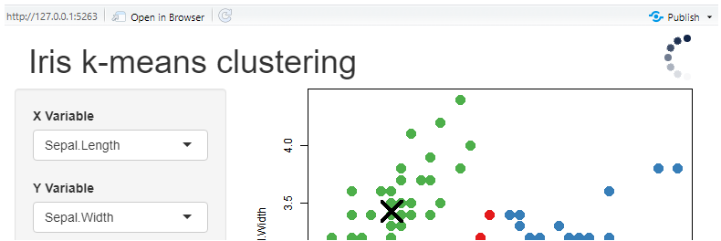
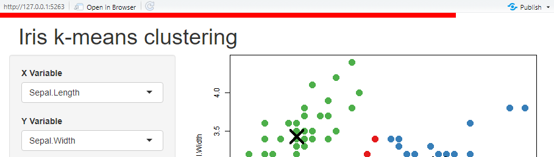
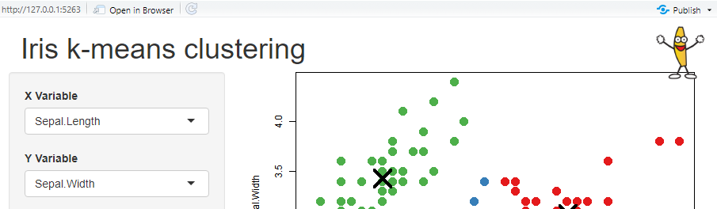
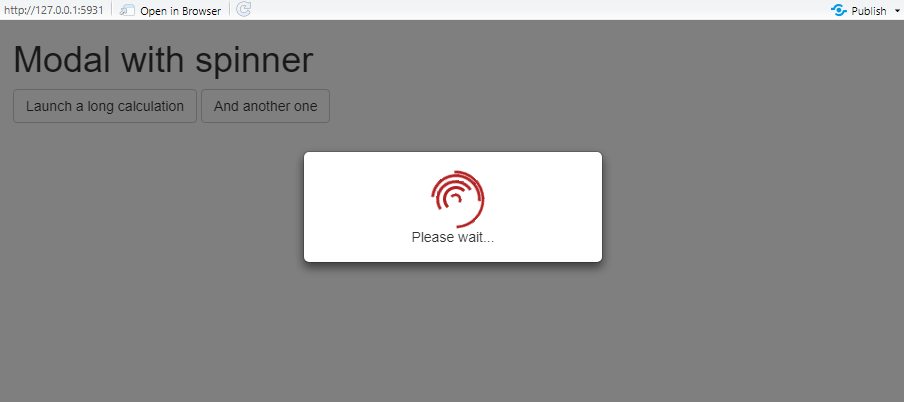
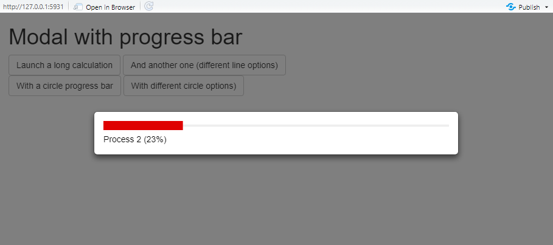

# Busy indicator for shiny apps

``` r

library(shinybusy)
```

{shinybusy} allow to add **global** indicators to a {shiny} application
to show the user that application is busy (something is happening
server-side). There is three main type of indicators :

- automatic, just add a line in UI, the indicator will show up whenever
  server is busy.
- manual, activate the indicator from the server when you want it to be
  displayed.
- modal indicators, display a modal and prevent user to interact with
  the application.

## Automatic indicators

The indicator will be displayed each time a calculation take more than
the timeout defined (default to 1000ms), you don’t have to intervene in
the server.

Three indicators are available :

- a spinner : with
  [`add_busy_spinner()`](https://dreamrs.github.io/shinybusy/reference/add_busy_spinner.md).

``` r

# Add in UI
add_busy_spinner(spin = "fading-circle")
```



- a top progress bar : with
  [`add_busy_bar()`](https://dreamrs.github.io/shinybusy/reference/add_busy_bar.md).

``` r

add_busy_bar(color = "red", height = "8px")
```



- a GIF that will animate when app is busy : with :
  [`add_busy_gif()`](https://dreamrs.github.io/shinybusy/reference/add_busy_gif.md).

``` r

# Add in UI
add_busy_gif(
  src = "https://jeroen.github.io/images/banana.gif",
  height = 70, width = 70
)
```



## Manual indicators

The same types of indicators are available than for automatic
indicators, but this time functions starts with `use_*` and you have to
explicitly trigger the indicator server-side.

- spinner : with
  [`use_busy_spinner()`](https://dreamrs.github.io/shinybusy/reference/manual-spinner.md)
  :

``` r

# in UI
use_busy_spinner(spin = "fading-circle")

# in server
show_spinner() # show the spinner
hide_spinner() # hide the spinner
```

- top progress bar : with
  [`use_busy_bar()`](https://dreamrs.github.io/shinybusy/reference/manual-progressbar.md)
  :

``` r

# in UI
use_busy_bar(color = "#01DF01", height = "15px")

# in server
update_busy_bar(0) # update with the desire value [0-100], 100 hide the bar
```

- GIF : with
  [`use_busy_gif()`](https://dreamrs.github.io/shinybusy/reference/manual-gif.md)
  :

``` r

# in UI
use_busy_gif(
  src = "https://jeroen.github.io/images/banana.gif",
  height = 70, width = 70
)

# in server
play_gif() # play animation
stop_gif() # stop animation
```

## Modal indicators

Display an indicator (a spinner or a progress bar) in a modal window,
this prevent user to interact with the app and launch other calculation
when something is already happening in the server. Those functions are
only used server-side.

- Spinner :

``` r

# in server
show_modal_spinner() # show the modal window
remove_modal_spinner() # remove it when done
```



- Progress bar :

``` r

# in server
show_modal_progress_line() # show the modal window
update_modal_progress(0.2) # update progress bar value
remove_modal_progress() # remove it when done
```



Don’t forget to remove the modal window when computation is finished !

## Full-page loading indicator

Cover the whole page with a loading indicator from the server, using the
Loading module of [Notiflix](https://notiflix.github.io/loading). Unlike
modals, the indicator is not a Shiny modal window and is shared by all
modules in the app. To cover a single element, see
[`block()`](https://dreamrs.github.io/shinybusy/reference/block.md).

``` r

# in server
show_loading("Calculating...", type = "circle") # show the indicator
update_loading("Almost done...") # change its text
remove_loading() # remove it when done
```

Use `remove_loading(timeout = 500)` to remove the indicator after a
delay in milliseconds.

## Notifications

Show notifications and reports to user through JavaScript library
[Notiflix](https://notiflix.github.io/). Four appearance are available:
success, failure, info and warning. Notifications are fully
configurable.

``` r

# success notification
notify_success("Well done!")

# report failure
report_failure(
  "Oups...",
  "Something went wrong"
)
```
